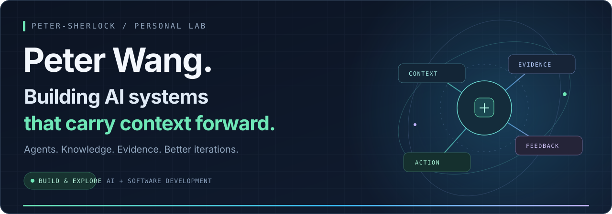
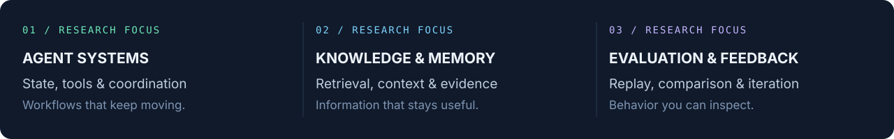
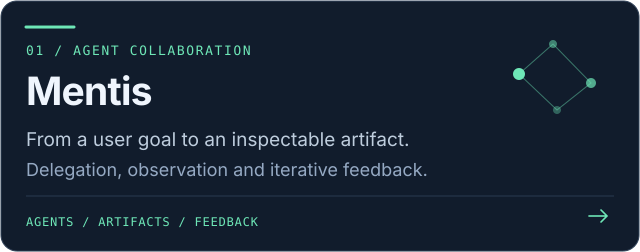
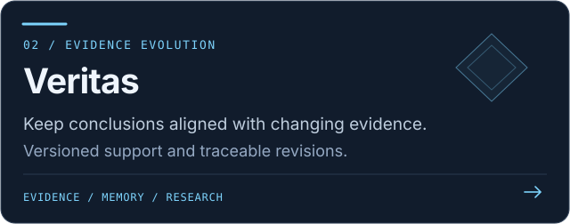
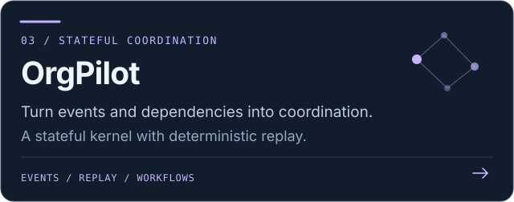
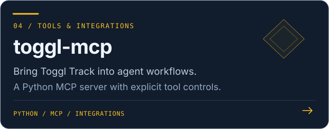
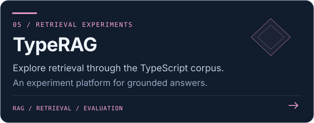
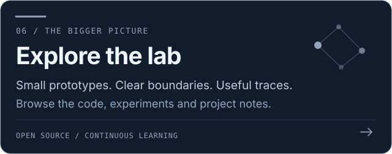
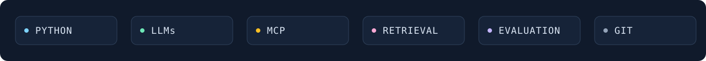

 

<a href="#about">About</a> &nbsp; · &nbsp;
<a href="#research-focus">Focus</a> &nbsp; · &nbsp;
<a href="#selected-projects">Projects</a> &nbsp; · &nbsp;
<a href="#toolbox">Toolbox</a> &nbsp; · &nbsp;
<a href="mailto:wangp3244@gmail.com">Contact</a>

 

## About

Hi, I’m **Peter**, an AI and software developer exploring the systems around language models.

I like building software that can **hold onto context, respond to changing evidence, and improve through feedback**. My projects explore agent collaboration, stateful workflows, retrieval, and reproducible evaluation.

> **Make context useful. Make behavior inspectable.**

## Research focus

## Selected projects

Five projects, connected by a shared interest in context, coordination, and feedback. **Click a card to explore the repository.**

<table>
<tr>
<td width="50%"></td>
<td width="50%"></td>
</tr>
<tr>
<td width="50%"></td>
<td width="50%"></td>
</tr>
<tr>
<td width="50%"></td>
<td width="50%"></td>
</tr>
</table>

## Toolbox

I use these tools and ideas to build small, inspectable prototypes. Each repository documents its own implementation, validation, and current boundaries.

## How I approach building

| Start with the workflow | Keep the evidence | Iterate with feedback |
| :--- | :--- | :--- |
| Understand the goal, state, and constraints before adding complexity. | Preserve artifacts, event traces, and evaluation results so changes can be inspected. | Compare what changed, check the behavior, and let observations guide the next step. |

<strong>Currently exploring</strong>

 

- **Long-running agent workflows:** keeping goals, state, and user feedback across iterations.
- **Evolving evidence and memory:** revisiting conclusions when sources or constraints change.
- **Reproducible evaluation:** comparing behavior with frozen inputs and inspectable traces.
- **Practical integrations:** giving agents useful tools with clear controls and outcomes.

 

 

**Let’s talk about agents, retrieval, and useful software.**

<a href="mailto:wangp3244@gmail.com">wangp3244@gmail.com</a> &nbsp; · &nbsp;
<a href="https://github.com/Peter-Sherlock?tab=repositories">Explore my repositories</a>

